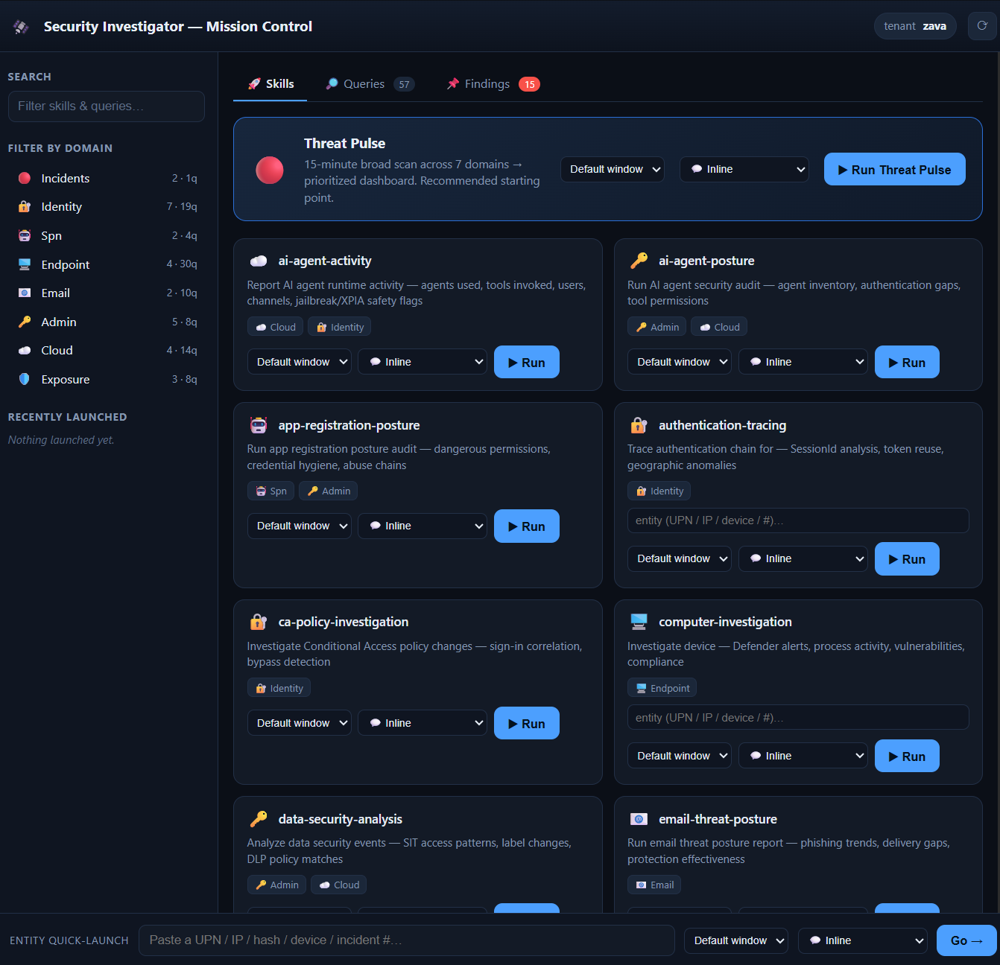
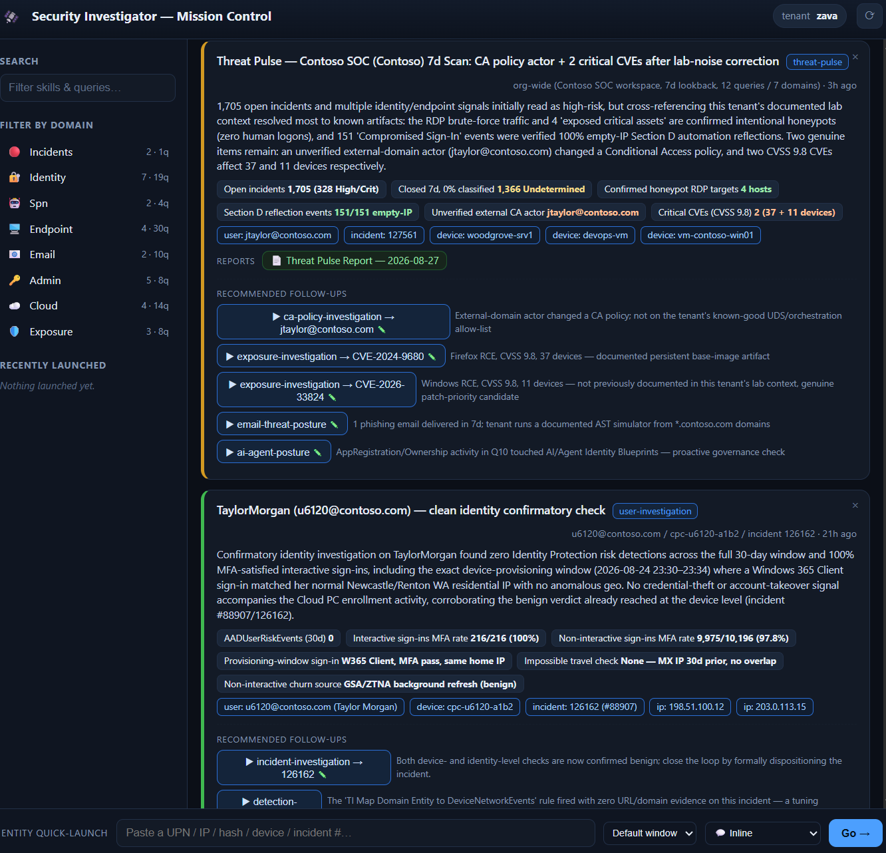

# 🔒 Security Investigation Automation System

**Comprehensive, automated security investigations powered by Microsoft Sentinel, Defender XDR, Graph API, and threat intelligence — with 33 specialized Agent Skills**

> 🎛️ **Walkthrough using GitHub Copilot (15 min):** See the new Mission Control canvas app in action — [Watch on LinkedIn](https://lnkd.in/p/gm4yB-9Y). A guided tour of the launchable skills dashboard: filter investigation skills by domain, search, and one-click launch skills or route an entity to the right investigation.

> 📺 **Walkthrough using VS Code:** See this project in action — [Watch on YouTube](https://youtu.be/3UFqWA4cmoE?t=1470) (starts at the Security Investigator demo). Covers the end-to-end workflow: natural language investigations, MCP server integration, KQL query execution, threat intelligence enrichment, and automated report generation.

An investigation automation framework that combines **GitHub Copilot**, **VS Code Agent Skills**, and **Model Context Protocol (MCP) servers** to enable natural language security investigations. Ask questions like *"Investigate this user for the last 7 days"* or *"Is this IP malicious?"* and get comprehensive analysis with KQL queries, threat intelligence correlation, and professional reports.

> 🖥️ **Also runs in the [GitHub Copilot app](https://github.com/features/ai/github-app) (desktop)** — ideal for **scheduled automations** (unattended Threat Pulse / Threat Intel Campaign runs). It uses a worktree-per-session model with a few setup differences from VS Code — see [Running in the GitHub Copilot App](#️-running-in-the-github-copilot-app-desktop).

### Quick Start (TL;DR)

```powershell
# 1. Clone and open in VS Code
git clone https://github.com/SCStelz/security-investigator.git
code security-investigator

# 2. Set up Python environment
python -m venv .venv
.venv\Scripts\Activate.ps1          # Windows
# source .venv/bin/activate          # macOS/Linux
pip install --require-hashes -r requirements.lock   # Hash-verified (recommended)
# pip install -r requirements.txt                   # Without hash verification

# 3. Configure environment
copy config.json.template config.json
# Edit config.json → add your Sentinel workspace ID, tenant ID
copy .env.template .env
# Edit .env → add your API tokens (ipinfo, AbuseIPDB, vpnapi, Shodan)

# 4. Configure MCP servers
copy .vscode\mcp.json.template .vscode\mcp.json
# All platform servers are pre-configured — just needs a GitHub PAT on first use
# GitHub Copilot app / CLI instead? Use the user-scope template:
#   copy .copilot\mcp-config.json.template $env:USERPROFILE\.copilot\mcp-config.json
#   (works as-is — see "Running in the GitHub Copilot App" below)

# 5. Open Copilot Chat (Ctrl+Shift+I) in Agent mode and start with:
#    "Run a threat pulse scan"
```

**🚀 Recommended first run:** The **Threat Pulse** skill is the best starting point. It runs a broad-spectrum scan across 9 security domains (incidents, identity, endpoint, exposure, email, UEBA, auth spray, privileged ops, CVEs) and produces prioritized findings with color-coded verdicts (🔴 Escalate / 🟠 Investigate / 🟡 Monitor / ✅ Clear). Each finding includes a drill-down recommendation pointing to a specialized skill — so after the scan, you'll know exactly where to focus and which follow-up command to run.

**Other example prompts:**
```
"Investigate user@domain.com for the last 7 days"    → user-investigation
"Analyze incident 12345"                              → incident-investigation
"Is this IP malicious? 203.0.113.42"                  → ioc-investigation
"What skills do you have access to?"                  → lists all 33 skills
```

**For detailed workflows and KQL queries:**
→ [.github/copilot-instructions.md](.github/copilot-instructions.md) (universal patterns, skill detection)
→ [.github/skills/](.github/skills/) (33 specialized investigation workflows)
→ [queries/](queries/) (verified KQL query library)

---

## Architecture Overview

```
┌────────────────────────────────────────────────────────────────────┐
│                     GitHub Copilot (VS Code)                       │
├────────────────────────────────────────────────────────────────────┤
│                  .github/copilot-instructions.md                   │
│            (Skill detection, universal patterns, routing)          │
├────────────────────────────────────────────────────────────────────┤
│                     .github/skills/*.md                            │
│       (33 specialized workflows with KQL, risk assessment)         │
├────────────────────────────────────────────────────────────────────┤
│                     MCP Servers (Platform)                         │
│  ┌─────────────┐  ┌──────────────┐  ┌───────────────────────────┐  │
│  │ Sentinel    │  │ Graph API    │  │ Sentinel Triage (XDR)     │  │
│  │ Data Lake   │  │ (Identity)   │  │ (Advanced Hunting)        │  │
│  └─────────────┘  └──────────────┘  └───────────────────────────┘  │
│  ┌─────────────┐  ┌──────────────┐  ┌───────────────────────────┐  │
│  │ KQL Search  │  │ Microsoft    │  │ Azure MCP Server          │  │
│  │ (Schema)    │  │ Learn (Docs) │  │ (ARM + Monitor)           │  │
│  └─────────────┘  └──────────────┘  └───────────────────────────┘  │
│  ┌─────────────┐  ┌──────────────┐                                 │
│  │ Sentinel    │  │ Perception   │                                 │
│  │ Graph (Rel) │  │ (optional)   │                                 │
│  └─────────────┘  └──────────────┘                                 │
├────────────────────────────────────────────────────────────────────┤
│               MCP Apps (Local Custom Servers)                      │
│  ┌─────────────┐  ┌──────────────┐  ┌───────────────────────────┐  │
│  │ Geomap      │  │ Heatmap      │  │ Incident Comment          │  │
│  │ (Attack Map)│  │ (Patterns)   │  │ (Sentinel Integration)    │  │
│  └─────────────┘  └──────────────┘  └───────────────────────────┘  │
├────────────────────────────────────────────────────────────────────┤
│                      Python Utilities                              │
│ generate_report_from_json.py  │  enrich_ips.py  │  report_generator│
└────────────────────────────────────────────────────────────────────┘
```

**Key Components:**
- **33 Agent Skills** — Modular investigation workflows for incidents, users, devices, IoCs, authentication, scope drift (SPN/User/Device), MCP monitoring, exposure management, AI agent posture and runtime activity, app registration posture, identity posture, data security analysis, email threat posture, MITRE ATT&CK coverage, ingestion analysis, detection authoring, threat pulse scanning, threat-intel hunting campaigns, tenant-context memory review, SVG dashboards, optional Microsoft Perception skills (threat intel, protection, attack investigation, alert triage, detection tuning), and more
- **7 MCP Server Integrations** — Sentinel Data Lake (incl. Exposure Graph tools), Graph API, Defender XDR Triage, KQL Search, Microsoft Learn, Azure MCP Server, and the optional Microsoft Perception MCP
- **3 Local MCP Apps** — Interactive heatmaps, geographic attack maps, incident commenting
- **Python Utilities** — HTML report generation with IP enrichment (geolocation, VPN detection, abuse scores, Shodan port/service/CVE intelligence)

---

## 🤖 Agent Skills

This system uses **[VS Code Agent Skills](https://code.visualstudio.com/docs/copilot/customization/agent-skills)** to provide modular, domain-specific investigation workflows. Skills are automatically detected based on keywords in your prompts.

### Available Skills (33)

| Category | Skill | Description | Trigger Keywords |
|----------|-------|-------------|------------------|
| ⚡ Quick Scan | **[threat-pulse](/.github/skills/threat-pulse/SKILL.md)** | Rapid broad-spectrum security scan across 7 domains: active incidents, identity (human + NHI), endpoint, email threats, admin & cloud ops, exposure. Prioritized Threat Pulse findings with color-coded verdicts and drill-down recommendations | "threat pulse", "quick scan", "security pulse", "morning hunt", "what can you do", "where do I start", "what's going on" |
| 🔍 Core Investigation | **[computer-investigation](/.github/skills/computer-investigation/SKILL.md)** | Device security analysis for Entra Joined, Hybrid Joined, and Entra Registered devices: Defender alerts, compliance, logged-on users, vulnerabilities, process/network/file events | "investigate computer", "investigate device", "investigate endpoint", "check machine", hostname |
| 🔍 Core Investigation | **[honeypot-investigation](/.github/skills/honeypot-investigation/SKILL.md)** | Honeypot security analysis: attack patterns, threat intel, vulnerabilities, executive reports | "honeypot", "attack analysis", "threat actor" |
| 🔍 Core Investigation | **[incident-investigation](/.github/skills/incident-investigation/SKILL.md)** | Comprehensive incident analysis for Defender XDR and Sentinel incidents: criticality assessment, entity extraction, filtering, recursive entity investigation | "investigate incident", "incident ID", "analyze incident", "triage incident", incident number |
| 🔍 Core Investigation | **[ioc-investigation](/.github/skills/ioc-investigation/SKILL.md)** | Indicator of Compromise analysis: IP addresses, domains, URLs, file hashes. Includes Defender Threat Intelligence, Sentinel TI tables, CVE correlation, organizational exposure | "investigate IP", "investigate domain", "investigate URL", "investigate hash", "IoC", "is this malicious" |
| 🔍 Core Investigation | **[user-investigation](/.github/skills/user-investigation/SKILL.md)** | Entra ID user security analysis: sign-ins, anomalies, MFA, devices, audit logs, incidents, Identity Protection, HTML reports | "investigate user", "security investigation", "check user activity", UPN/email |
| 🔐 Auth & Access | **[authentication-tracing](/.github/skills/authentication-tracing/SKILL.md)** | Entra ID authentication chain forensics: SessionId analysis, token reuse vs interactive MFA, geographic anomalies | "trace authentication", "SessionId analysis", "token reuse", "geographic anomaly" |
| 🔐 Auth & Access | **[ca-policy-investigation](/.github/skills/ca-policy-investigation/SKILL.md)** | Conditional Access policy forensics: sign-in failure correlation, policy state changes, security bypass detection | "Conditional Access", "CA policy", "device compliance", "policy bypass" |
| 📈 Behavioral Analysis | **[scope-drift-detection/device](/.github/skills/scope-drift-detection/device/SKILL.md)** | Device process drift: configurable-window baseline, 5-dimension Drift Score (Volume/Processes/Accounts/Chains/Signing), fleet-wide or single-device, Heartbeat uptime corroboration | "device drift", "endpoint drift", "process baseline", "device behavioral change" |
| 📈 Behavioral Analysis | **[scope-drift-detection/spn](/.github/skills/scope-drift-detection/spn/SKILL.md)** | SPN scope drift: 90-day baseline vs 7-day comparison, 5-dimension Drift Score, correlated with AuditLogs, SecurityAlert, DeviceNetworkEvents | "scope drift", "service principal drift", "SPN behavioral change", "SPN drift" |
| 📈 Behavioral Analysis | **[scope-drift-detection/user](/.github/skills/scope-drift-detection/user/SKILL.md)** | User scope drift: 90-day baseline vs 7-day comparison, dual Drift Scores (7-dim interactive + 6-dim non-interactive), correlated with AuditLogs, SecurityAlert, Identity Protection, CloudAppEvents, EmailEvents | "user drift", "user scope drift", "user behavioral change", "UPN drift" |
| 🛡️ Posture & Exposure | **[exposure-investigation](/.github/skills/exposure-investigation/SKILL.md)** | Vulnerability & Exposure Management reporting: CVE assessment with exploit/CVSS data, security configuration compliance, end-of-support software, ExposureGraph critical assets, attack paths, Defender health, certificate status | "vulnerability report", "exposure report", "CVE assessment", "security posture", "TVM" |
| 🛡️ Posture & Exposure | **[ai-agent-posture](/.github/skills/ai-agent-posture/SKILL.md)** | AI agent security posture audit for Copilot Studio and M365 Copilot agents: agent inventory, authentication gaps, access control misconfigurations, MCP tool proliferation, knowledge source exposure, XPIA risk, credential detection, Agent Security Score | "AI agent posture", "agent security audit", "Copilot Studio agents", "agent inventory", "unauthenticated agents", "agent sprawl" |
| 🛡️ Posture & Exposure | **[ai-agent-activity](/.github/skills/ai-agent-activity/SKILL.md)** | AI agent **runtime** activity (the runtime companion to `ai-agent-posture`) for Agent 365, Copilot Studio, M365 Copilot and Work IQ: agents used, tools/connectors invoked, users and channels, token usage, prompt/reply content, and Prompt Shield jailbreak / XPIA verdicts. Auto-detects the available data planes (`UnifiedAgentObservability` in the Data Lake, `CloudAppEvents`, `CopilotActivity`); tenant-wide, single-agent or single-user scope | "agent activity", "AI agent usage", "who is using agents", "agent runtime", "agent tool usage", "jailbreak activity", "Agent 365 activity", "UnifiedAgentObservability" |
| 🛡️ Posture & Exposure | **[app-registration-posture](/.github/skills/app-registration-posture/SKILL.md)** | App registration and service principal security posture: Graph API permission inventory (dangerous grants, permission concentration), app ownership risk, credential hygiene (stale secrets, multi-credential apps), cross-tenant SPN exposure, KQL attack chain detection (AuditLogs, AADServicePrincipalSignInLogs, MicrosoftGraphActivityLogs), App Permission Risk Score with 5 dimensions | "app registration posture", "app registration abuse", "service principal permissions", "dangerous app permissions", "app ownership", "overprivileged apps" |
| 🛡️ Posture & Exposure | **[email-threat-posture](/.github/skills/email-threat-posture/SKILL.md)** | Email threat protection posture report for Microsoft Defender for Office 365: inbound mail flow overview, threat composition (phishing/spam/malware), email authentication (DMARC/DKIM/SPF/CompAuth), ZAP post-delivery remediation, Safe Links click protection, attachment analysis, detection method breakdown, MDO security incidents, Email Protection Score with 5 dimensions. Inline chat, markdown file, and SVG dashboard output | "email threat report", "email security posture", "phishing report", "MDO report", "Defender for Office 365 report", "ZAP effectiveness", "Safe Links report", "DMARC report" |
| 🛡️ Posture & Exposure | **[identity-posture](/.github/skills/identity-posture/SKILL.md)** | Identity security posture report using IdentityAccountInfo (MDI/Advanced Hunting): multi-provider account inventory (Entra ID, AD, Okta, SailPoint, CyberArk, Ping), privileged account audit with role distribution, stale/disabled/deleted account hygiene, password posture, risk distribution, multi-provider identity linking, MDI tag analysis, Identity Posture Score with 5 dimensions. Inline chat and markdown file output | "identity posture", "identity security report", "account hygiene", "stale accounts", "privileged accounts", "password posture", "identity providers", "honeytoken" |
| 🔒 Data Security | **[data-security-analysis](/.github/skills/data-security-analysis/SKILL.md)** | DataSecurityEvents (Purview/IRM) analysis: SIT access breakdowns, user risk ranking, file inventory, DLP policy correlation, Copilot SIT exposure, SIT GUID-to-name resolution, anomaly detection. Designed for 100k+ user environments | "data security", "sensitive information type", "SIT access", "DLP events", "DataSecurityEvents", "EDM access", "insider risk activity", "Purview data security" |
| 📊 Visualization | **[geomap-visualization](/.github/skills/geomap-visualization/SKILL.md)** | Interactive world map visualization for Sentinel data: attack origin maps, geographic threat distribution, IP geolocation with enrichment drill-down | "geomap", "world map", "geographic", "attack map", "attack origins" |
| 📊 Visualization | **[heatmap-visualization](/.github/skills/heatmap-visualization/SKILL.md)** | Interactive heatmap visualization for Sentinel data: attack patterns by time, activity grids, IP vs hour matrices, threat intel drill-down | "heatmap", "show heatmap", "visualize patterns", "activity grid" |
| 📊 Visualization | **[svg-dashboard](/.github/skills/svg-dashboard/SKILL.md)** | SVG data visualization dashboards: dual-mode renderer supporting manifest-driven structured dashboards (from skill reports) and freeform adaptive visualizations from ad-hoc investigation data. 14-widget component library | "generate SVG dashboard", "create a visual dashboard", "visualize this report", "SVG from this data" |
| 🔧 Tooling & Monitoring | **[detection-authoring](/.github/skills/detection-authoring/SKILL.md)** | Create, deploy, update, and manage Defender XDR custom detection rules via Graph API. Query adaptation from Sentinel KQL, manifest-driven batch deployment via PowerShell, lifecycle management. Can instead hand you a prefilled **Detection Wizard link** to review and save yourself (`wizard_link.py`) | "create custom detection", "deploy detection", "detection rule", "custom detection", "deploy rule", "batch deploy", "wizard link" |
| 🔧 Tooling & Monitoring | **[kql-query-authoring](/.github/skills/kql-query-authoring/SKILL.md)** | KQL query creation using schema validation, community examples, Microsoft Learn | "write KQL", "create KQL query", "help with KQL", "query [table]" |
| 🔧 Tooling & Monitoring | **[mcp-usage-monitoring](/.github/skills/mcp-usage-monitoring/SKILL.md)** | MCP server usage monitoring and audit: Graph MCP endpoint analysis, Sentinel MCP auth events, Azure MCP ARM operations, workspace query governance, MCP Usage Score with 5 health/risk dimensions | "MCP usage", "MCP server monitoring", "MCP activity", "MCP audit", "Graph MCP", "Sentinel MCP", "Azure MCP" |
| 🔧 Tooling & Monitoring | **[sentinel-ingestion-report](/.github/skills/sentinel-ingestion-report/SKILL.md)** | Sentinel workspace ingestion & cost analysis: table-level volume breakdown, tier classification (Analytics/Basic/Data Lake), SecurityEvent/Syslog/CommonSecurityLog deep dives, ingestion anomaly detection, analytic rule inventory via REST API, custom detection inventory via Graph API, rule health via SentinelHealth, data lake tier migration candidates, license benefit analysis (DfS P2, M365 E5) | "ingestion report", "usage report", "data volume", "cost analysis", "table breakdown", "data lake tier", "ingestion anomaly", "cost optimization" |
| 🔧 Tooling & Monitoring | **[mitre-coverage-report](/.github/skills/mitre-coverage-report/SKILL.md)** | MITRE ATT&CK coverage analysis: YAML-driven PowerShell pipeline gathers analytic rule MITRE tags, custom detection techniques, SOC Optimization recommendations, alert/incident operational data. Tactic-level coverage matrix, technique-level drill-down with rule mapping, coverage gap identification, SOC Optimization threat scenario alignment, untagged rule remediation, MITRE Coverage Score (5 weighted dimensions). Inline chat and markdown file output | "MITRE coverage", "ATT&CK coverage", "MITRE report", "tactic coverage", "technique coverage", "coverage gaps", "MITRE score", "detection coverage report", "MITRE matrix" |
| 🔧 Tooling & Monitoring | **[threat-intel-campaign](/.github/skills/threat-intel-campaign/SKILL.md)** | Turns a published threat-intelligence article into a **tested hunting campaign**: reads a platform-agnostic RSS/Atom feed (or a single article URL), applies a huntability relevance gate, writes/tests/tunes KQL hunts and publishes them as a campaign file under `queries/threat-intelligence/YYYY-MM/`. Side-effect-free (no git commits or PRs); used by the weekly automation | "threat intel campaign", "ingest threat intelligence", "TI feed", "write hunts from this article", "threat intelligence blog", "build a hunting campaign" |
| 🔧 Tooling & Monitoring | **[context-memory-review](/.github/skills/context-memory-review/SKILL.md)** | Weekly, **propose-only** review of your tenant-context memory file against recent SOC scan reports (e.g. Threat Pulse) and the Mission Control findings log. Surfaces candidate ADD / MODIFY / FLAG changes for human approval; never edits the context file, commits or opens a PR (see [Persistent Tenant Context](#-optional-persistent-tenant-context)) | "review my context file", "review tenant context", "propose context updates", "compact findings to memory" |
| 🧠 Perception (optional) | **[perception-extract-threat-intel](/.github/skills/perception-extract-threat-intel/SKILL.md)** | Find and read threat-intelligence reports Microsoft Perception **already produced** (free): recent articles, topic search ("has anything on LiteLLM been analyzed?"), TTPs with detection opportunities, indicators, threat-intel-platform gaps, hunting queries. Optionally verifies the hunting queries in your tenant, hands TTPs to detection authoring, and — only after an explicit yes, with the cost shown — starts a new *Extract threat intelligence* run for an article or URL | "perception threat intel", "has perception analyzed", "analyze this article with perception", "analyzed threat intelligence articles" |
| 🧠 Perception (optional) | **[perception-protect-against-threat](/.github/skills/perception-protect-against-threat/SKILL.md)** | "Are we protected against threat X?" — reuses (or, on confirmation, runs) Perception's *Protect against a threat* playbook: threat intel, tenant-aware detection proposals (ready to deploy / requires tuning), recon scope and ranked posture priorities, then verifies against your tenant. Hands detections that need tuning to `perception-tune-detection` | "perception protect against a threat", "protect against this threat with perception", "perception detections for article" |
| 🧠 Perception (optional) | **[perception-investigate-attack](/.github/skills/perception-investigate-attack/SKILL.md)** | Reuse or start Perception's *Investigate attack* playbook for a Defender incident: attack story, timeline, techniques, indicators, affected assets. Compares with this repo's own incident investigation and validates the run (a finished session is not necessarily a useful one) | "perception investigate incident", "ask perception about incident" |
| 🧠 Perception (optional) | **[perception-triage-alert](/.github/skills/perception-triage-alert/SKILL.md)** | Triage a Defender alert with Perception's *Triage Alert* playbook: checks the alert type against Microsoft's documented (growing) supported list and warns instead of refusing, reuses an existing triage session (manual or automatic) or, only after an explicit yes with the cost shown, starts one. A `Not set` classification is treated as inconclusive, and the verdict is shown next to Defender's current classification with disagreements flagged for a human. Never changes the alert | "perception triage alert", "triage this alert with perception", "did perception triage this alert", "perception alert verdict" |
| 🧠 Perception (optional) | **[perception-tune-detection](/.github/skills/perception-tune-detection/SKILL.md)** | Human-in-the-loop tuning of detections proposed by an existing Perception session (Protect against a threat or Detect emerging threats): replays the KQL against your tenant history, slices the noise, tunes with your approval, proves the result, and re-encodes a verified **Detection Wizard link**. Never deploys | "tune perception detection", "requires tuning", "perception detection noisy", "re-encode wizard link" |

### How Skills Work

1. You ask Copilot a question (e.g., "Investigate user@domain.com for the last 7 days")
2. Copilot detects keywords and loads the appropriate skill from `.github/skills/<skill-name>/SKILL.md`
3. The skill provides specialized workflow, KQL queries, and risk assessment criteria
4. Universal patterns from `.github/copilot-instructions.md` are inherited automatically

### Triggering Skills with Natural Language

You don't need to mention the skill name — keywords are detected automatically:

| What you say | Skill triggered |
|--------------|-----------------|
| "Investigate user@domain.com for the last 7 days" | user-investigation |
| "Analyze incident 12345" | incident-investigation |
| "Is this IP malicious? 203.0.113.42" | ioc-investigation |
| "Check the device WORKSTATION-01 for threats" | computer-investigation |
| "Show attack patterns on a heatmap" | heatmap-visualization |
| "Generate an SVG dashboard from the report" | svg-dashboard |
| "Map the geographic origins of these attacks" | geomap-visualization |
| "Write a KQL query to find failed sign-ins" | kql-query-authoring |
| "Trace this authentication back to the original MFA" | authentication-tracing |
| "Detect scope drift in service principals" | scope-drift-detection/spn |
| "Check user behavioral drift for user@domain.com" | scope-drift-detection/user |
| "Analyze device process drift across the fleet" | scope-drift-detection/device |
| "Show me MCP server usage for the last 30 days" | mcp-usage-monitoring |
| "Generate a Sentinel ingestion report" | sentinel-ingestion-report |
| "Create custom detections for Event ID 4799" | detection-authoring |
| "Audit AI agent security posture" | ai-agent-posture |
| "Who accessed files with credit card numbers?" | data-security-analysis |
| "Generate an email threat protection report" | email-threat-posture |
| "Run an identity posture report" | identity-posture |
| "Generate a MITRE ATT&CK coverage report" | mitre-coverage-report |
| "Run a threat pulse scan" | threat-pulse |
| "Audit our app registration security posture" | app-registration-posture |
| "Who is using AI agents, and were there any jailbreak attempts?" | ai-agent-activity |
| "Build a hunting campaign from this threat intel article: <URL>" | threat-intel-campaign |
| "Review my tenant context file against recent scans" | context-memory-review |
| "Has Perception analyzed anything on LiteLLM?" | perception-extract-threat-intel |
| "Use Perception to see if we're protected against LiteLLM attacks" | perception-protect-against-threat |
| "Ask Perception to investigate incident 12345" | perception-investigate-attack |
| "Did Perception triage this alert, and is it a false positive?" | perception-triage-alert |
| "Tune the detections from that Perception session" | perception-tune-detection |

### Follow-ups and Chaining

After running an investigation, ask follow-up questions without re-running the entire workflow:

```
Is that IP a VPN?
Trace authentication for that suspicious location
Was MFA used for those sign-ins?
```

Skills can be chained for comprehensive analysis:

```
1. "Investigate incident 12345" → incident-investigation extracts entities
2. "Now investigate the user from that incident" → user-investigation runs on extracted UPN
3. "Check if that IP is malicious" → ioc-investigation analyzes the suspicious IP
4. "Show me a heatmap of the attack patterns" → heatmap-visualization
```

Copilot uses existing investigation data from `temp/investigation_*.json` when available.

### Discovering Skills

```
What investigation skills do you have access to?
Explain the high-level workflow of the user-investigation skill
What data sources does the ioc-investigation skill use?
```

**📖 Reference:** [GitHub Agent Skills Documentation](https://docs.github.com/en/copilot/concepts/agents/about-agent-skills)

### Authoring New Skills & Queries from Investigations

Ad-hoc investigations naturally evolve into reusable assets. After completing an investigation, ask Copilot to package the verified queries, schema pitfalls, and analytical logic into a new SKILL.md or query file.

```
"Based on the investigation we just completed, create a new reusable skill"
"Read this threat intel article: <URL> — extract TTPs and IOCs, then write, test, and tune a queries file for reusable threat hunts"
```

---

### 🧠 Microsoft Perception skills (optional)

[Microsoft Perception](https://techcommunity.microsoft.com/blog/perception-blog/whats-new-with-microsoft-perception-at-ignite-2026/4571834) is agentic security in the Defender portal: playbooks that extract threat intelligence, propose tenant-aware detections and posture fixes, and investigate attacks. Five skills sit on top of its [MCP server](#7-microsoft-perception-mcp-server-optional). **Perception proposes; this repo verifies, tunes and hands you the result.** They need the Perception MCP (Perception is in Limited Public Preview) and stop with setup guidance if it isn't configured.

| Skill | Defender portal playbook | Typical use | New run (estimate) |
|-------|--------------------------|-------------|--------------------|
| `perception-extract-threat-intel` | Extract threat intelligence | Find/read existing intel, search by topic, analyze a new article or URL | $0 to reuse; ≈ $3.89–$6.80 new |
| `perception-protect-against-threat` | Protect against a threat | "Are we protected against X?": intel, detections, posture priorities | $0 to reuse; ≈ $209–$527 new |
| `perception-investigate-attack` | Investigate attack | Attack story for a Defender incident | $0 to reuse; ≈ $2.69–$18.82 new |
| `perception-triage-alert` | Triage alert | Verdict (true/false positive) for one Defender alert, checked against Defender's own classification | $0 to reuse; ≈ $0.33–$0.44 new |
| `perception-tune-detection` | *(none: works on a finished session's detection report)* | Tune a proposed detection against your data | $0 (never starts a session) |

*Costs are a snapshot (2026-11-19) of the Defender portal's estimate page, not a quote; actual costs can be higher and billing is not visible through the MCP.*

**How they behave**
- **Reuse before spend.** Perception sessions are often already run (and paid for) by a colleague. The skills search existing sessions first (the MCP cannot search, so a small local cache in `temp/` is built with `.github/skills/perception-shared/session_cache.py`). A new run needs an explicit yes after the cost, runtime and agent identity are shown — never from a bare keyword.
- **Read-only playbooks only.** Active-testing playbooks (`red-web-pentest`, `find-fix-web-app-security-risks`) are refused outright; they must be launched by a human in the portal.
- **Perception output is `[asserted]`, not `[verified]`.** Its detections are proposals. Hunting queries and indicator sweeps are re-run through this repo's KQL pre-flight against your tenant, and findings stay informational unless real tenant activity is found.
- **Validated, not trusted.** A `succeeded` session can contain only an audit log, and a `failed/stopped` one can still hold a good report, so every candidate is checked with `list_outputs`.
- **Nothing is deployed.** Detections leave as a prefilled **Detection Wizard link** that a person opens, reviews and saves.
- **Traceable.** Every report opens with a clickable link to the Perception session it came from; `session_cache.py check-links <report.md>` enforces it.

**Outputs** (gitignored, one subfolder per skill): `reports/perception/investigate-attack/`, `triage-alert/`, `protect-against-threat/`, `extract-threat-intel/`, `tune-detection/`. In [Mission Control](#️-mission-control-canvas-extension) the Perception cards show a 🧠 estimated-cost chip, reports open in the markdown preview (including Perception's verbatim detection reports) and tuned `.kql` files open in a built-in code viewer.

Shared rules, input shapes and the session lookup/validation protocol live in [`.github/skills/perception-shared/REFERENCE.md`](.github/skills/perception-shared/REFERENCE.md).

---

## 📁 Project Structure

```
security-investigator/
├── enrich_ips.py                # Standalone IP enrichment utility
├── config.json                  # Configuration (workspace IDs, mappings)
├── config.json.template         # Config template (committed to Git)
├── .env                         # API tokens (gitignored, auto-loaded by python-dotenv)
├── .env.template                # Token template (committed to Git)
├── requirements.txt             # Python dependencies
├── requirements.lock            # Hash-verified dependency lockfile
├── .vscode/
│   └── mcp.json.template       # VS Code MCP server config template (copy to mcp.json)
├── .copilot/
│   └── mcp-config.json.template # GitHub Copilot app/CLI MCP config template (copy to ~/.copilot/mcp-config.json)
├── .github/
│   ├── copilot-instructions.md  # Skill detection, universal patterns, routing
│   ├── manifests/               # Auto-generated discovery indexes
│   │   ├── discovery-manifest.yaml  # Query file + skill index (domains, MITRE, prompts)
│   │   └── build_manifest.py        # Manifest generator script
│   └── skills/                  # 33 Agent Skills (modular investigation workflows)
│       ├── ai-agent-activity/
│       ├── ai-agent-posture/
│       ├── app-registration-posture/
│       ├── authentication-tracing/
│       ├── ca-policy-investigation/
│       ├── computer-investigation/
│       ├── context-memory-review/
│       ├── data-security-analysis/
│       ├── detection-authoring/
│       ├── email-threat-posture/
│       ├── exposure-investigation/
│       ├── geomap-visualization/
│       ├── heatmap-visualization/
│       ├── honeypot-investigation/
│       ├── identity-posture/
│       ├── incident-investigation/
│       ├── ioc-investigation/
│       ├── kql-query-authoring/
│       ├── mcp-usage-monitoring/
│       ├── mitre-coverage-report/
│       ├── perception-extract-threat-intel/   # Optional: Microsoft Perception skills
│       ├── perception-investigate-attack/
│       ├── perception-protect-against-threat/
│       ├── perception-shared/                 # Shared reference + session_cache.py (not a skill)
│       ├── perception-triage-alert/
│       ├── perception-tune-detection/
│       ├── scope-drift-detection/
│       │   ├── spn/              # Service principal drift (5 dimensions)
│       │   ├── user/             # User account drift (7+6 dimensions)
│       │   └── device/           # Device process drift (5 dimensions)
│       ├── sentinel-ingestion-report/
│       ├── svg-dashboard/
│       ├── threat-intel-campaign/
│       ├── threat-pulse/
│       └── user-investigation/
├── queries/                     # Verified KQL query library (grep-searchable, by data domain)
│   ├── cloud/                  # Cloud app & exposure management queries
│   ├── email/                  # Defender for Office 365 email queries
│   ├── endpoint/               # Defender for Endpoint device queries
│   ├── identity/               # Entra ID / Azure AD identity queries
│   ├── incidents/              # SecurityIncident & SecurityAlert queries
│   └── network/                # Network telemetry queries
├── scripts/                     # Python utilities
│   ├── generate_report_from_json.py  # Report generator (main entry point)
│   ├── report_generator.py           # HTML report builder class
│   ├── investigator.py               # Data models and core types
│   ├── cleanup_old_investigations.py  # Automated cleanup (3+ days old)
│   └── generate_tocs.py              # Auto-generate query file TOCs
├── mcp-apps/                    # Local MCP servers (visualization, automation)
│   ├── sentinel-geomap-server/
│   ├── sentinel-heatmap-server/
│   └── sentinel-incident-comment/
├── docs/                        # Setup guides and reference documentation
├── authoring/                   # Blog drafts, writing guides, and marketing content
├── reports/                     # Generated investigation reports (organized by type)
│   ├── ai-agent-posture/       # AI agent security posture reports
│   ├── app-registration-posture/ # App registration posture reports
│   ├── computer-investigations/ # Device security investigation reports
│   ├── data-security/          # Data security SIT analysis reports
│   ├── email-threat-posture/   # Email threat protection posture reports
│   ├── exposure/               # Exposure management reports
│   ├── honeypot/               # Honeypot executive reports
│   ├── identity-posture/       # Identity security posture reports
│   ├── mcp-usage/              # MCP usage monitoring reports
│   ├── perception/             # Microsoft Perception outputs, one subfolder per perception-* skill
│   ├── scope-drift/            # Scope drift analysis reports
│   ├── sentinel/               # Sentinel ingestion & cost analysis reports
│   ├── threat-pulse/           # Threat Pulse scan reports
│   └── user-investigations/    # HTML user investigation reports
├── temp/                        # Investigation JSON files (auto-cleaned after 3 days)
└── archive/                     # Legacy code and design docs
```

### Query Library (`queries/`)

The `queries/` folder contains **verified, battle-tested KQL query collections** organized by detection scenario. These are the **Priority 2 lookup source** in the [KQL Pre-Flight Checklist](.github/copilot-instructions.md) — Copilot searches them before writing any ad-hoc KQL.

Each file uses a standardized metadata header for efficient `grep_search` discovery:
```markdown
# <Title>
**Tables:** <exact KQL table names>
**Keywords:** <searchable terms — attack techniques, scenarios, field names>
**MITRE:** <ATT&CK technique IDs, e.g., T1021.001, TA0008>
**Domains:** <domain tags for manifest indexing, e.g., identity, endpoint, email>
```

### Discovery Manifest (`.github/manifests/`)

The **discovery manifest** provides a machine-readable index of all query files and skills, enabling deterministic cross-referencing by domain and MITRE technique. The Threat Pulse skill loads this manifest to match findings to downstream query files and drill-down skills automatically.

- **`discovery-manifest.yaml`** — Compact index (~500 lines) with `title`, `path`, `domains`, `mitre`, and `prompt` fields for each query file and skill
- **`build_manifest.py`** — Generator script that scans `queries/` metadata headers and skill YAML frontmatter to produce the manifest

**How it works:**
1. Query files declare `**Domains:**` tags in their metadata header (valid tags: `incidents`, `identity`, `spn`, `endpoint`, `email`, `admin`, `cloud`, `exposure`)
2. Skills declare `threat_pulse_domains:` and `drill_down_prompt:` in their YAML frontmatter
3. `python .github/manifests/build_manifest.py` scans both and emits the manifest
4. The Threat Pulse skill reads the manifest to match non-✅ findings → relevant query files and skills by domain tag and MITRE technique overlap

**Regenerate after** creating or renaming query files/skills, or changing `Domains:`/`threat_pulse_domains:` values:
```powershell
python .github/manifests/build_manifest.py
```

---

## 🚀 Setup

### Prerequisites

| Requirement | Details |
|-------------|---------|
| **VS Code** | Version 1.99+ recommended (Agent mode + MCP support). |
| **GitHub Copilot** | Active subscription — [Copilot Pro+](https://github.com/features/copilot), Business, or Enterprise. Agent mode must be enabled. |
| **Python 3.8+** | For IP enrichment utility and report generation. [Download](https://www.python.org/downloads/) |
| **Azure CLI** | Required for Azure MCP Server (underlying auth) and `sentinel-ingestion-report` skill (`az monitor log-analytics query` for all KQL queries, `az rest` for analytic rule inventory, `az monitor log-analytics workspace table list` for tier classification). [Install](https://aka.ms/installazurecli). Authenticate: `az login --tenant <tenant_id>`, then `az account set --subscription <subscription_id>`. Requires **Log Analytics Reader** (KQL queries + table list) and **Microsoft Sentinel Reader** (analytic rule inventory) on the workspace. |
| **`log-analytics` CLI extension** | Required by the `sentinel-ingestion-report` skill for `az monitor log-analytics query` (all KQL queries in Phases 1-5). Install: `az extension add --name log-analytics`. Verify: `az extension list --query "[?name=='log-analytics']"`. |
| **PowerShell 7.0+** | Required for `sentinel-ingestion-report` skill (parallel query execution via `ForEach-Object -Parallel`). [Install](https://learn.microsoft.com/en-us/powershell/scripting/install/installing-powershell). Verify: `$PSVersionTable.PSVersion`. |
| **Node.js 18+** | Required for KQL Search MCP (`npx`) and building local MCP Apps. [Download](https://nodejs.org/) or install via `winget install OpenJS.NodeJS.LTS` (Windows) / `brew install node` (macOS). |
| **Microsoft Sentinel** | Log Analytics workspace with data. You'll need the workspace GUID and tenant ID. |
| **Entra ID Permissions** | If you can query Sentinel in the Azure Portal, you likely have sufficient access. The **Graph MCP server** requires a [one-time tenant provisioning](https://learn.microsoft.com/en-us/graph/mcp-server/get-started?tabs=http%2Cvscode) by an admin. See [MCP Server Setup](#-mcp-server-setup) for detailed per-server requirements. |
| **Microsoft.Graph PowerShell** | Required for `detection-authoring` skill (`CustomDetection.ReadWrite.All` — create/update/delete custom detection rules via Graph API). Also used by `sentinel-ingestion-report` skill for rule inventory (`CustomDetection.Read.All` — read-only, degrades gracefully if not installed). `Install-Module Microsoft.Graph.Authentication -Scope CurrentUser`. |
| **GitHub PAT** | `public_repo` scope — [Create one here](https://github.com/settings/tokens/new). Used by KQL Search MCP. |

### 1. Install Dependencies

Verify prerequisites:
```powershell
python --version   # Requires 3.8+
node --version     # Requires 18+ (needed for KQL Search MCP)
az --version       # Azure CLI (needed for Azure MCP Server, ingestion report skill)
pwsh --version     # Requires 7.0+ (needed for sentinel-ingestion-report skill)
```

If Node.js is missing: [Download](https://nodejs.org/) or run `winget install OpenJS.NodeJS.LTS` (Windows) / `brew install node` (macOS).
If Azure CLI is missing: [Install](https://aka.ms/installazurecli), then `az login --tenant <tenant_id>` and `az account set --subscription <subscription_id>`.
If the `log-analytics` extension is missing: `az extension add --name log-analytics` (required for `sentinel-ingestion-report` skill).

Set up Python environment:

```powershell
python -m venv .venv
.\.venv\Scripts\Activate.ps1
pip install -r requirements.txt
```

### 2. Configure Environment

Copy `config.json.template` to `config.json` and fill in your workspace details:

```json
{
  "sentinel_workspace_id": "YOUR_WORKSPACE_ID_HERE",
  "tenant_id": "YOUR_TENANT_ID_HERE",
  "subscription_id": "YOUR_SUBSCRIPTION_ID_HERE",
  "azure_mcp": {
    "resource_group": "YOUR_LOG_ANALYTICS_RESOURCE_GROUP",
    "workspace_name": "YOUR_LOG_ANALYTICS_WORKSPACE_NAME",
    "tenant": "YOUR_TENANT_ID_HERE",
    "subscription": "YOUR_SUBSCRIPTION_ID_HERE"
  },
  "output_dir": "reports"
}
```

| Setting | Required | Description |
|---------|----------|-------------|
| `sentinel_workspace_id` | Yes | Microsoft Sentinel (Log Analytics) workspace GUID |
| `tenant_id` | Yes | Entra ID (Azure AD) tenant ID for your Sentinel workspace |
| `subscription_id` | Yes | Azure subscription ID containing the Sentinel workspace |
| `azure_mcp.*` | Yes | Azure MCP Server parameters — resource group, workspace name, tenant, subscription. Required to avoid cross-tenant auth errors. |
| `output_dir` | No | Directory for HTML reports (default: `reports`) |

#### API Tokens (`.env` file)

API tokens for IP enrichment are stored in a `.env` file (gitignored) rather than `config.json` for security. Copy the template and add your keys:

```powershell
copy .env.template .env
# Edit .env with your token values
```

```dotenv
IPINFO_TOKEN=your_token_here
ABUSEIPDB_TOKEN=your_token_here
VPNAPI_TOKEN=your_token_here
SHODAN_TOKEN=your_token_here
```

These are auto-loaded by `enrich_ips.py` via `python-dotenv` — no manual sourcing needed.

| Token | Required | Description |
|-------|----------|-------------|
| `IPINFO_TOKEN` | Recommended | [ipinfo.io](https://ipinfo.io/) API token — geolocation, ASN, org. Free: 1K/day; token: 50K/month; paid plans include VPN detection |
| `ABUSEIPDB_TOKEN` | Recommended | [AbuseIPDB](https://www.abuseipdb.com/) API token — IP reputation scoring (0-100 confidence). Free: 1K/day |
| `VPNAPI_TOKEN` | Optional | [vpnapi.io](https://vpnapi.io/) API token — VPN/proxy/Tor detection. Not needed if ipinfo.io is on a paid plan |
| `SHODAN_TOKEN` | Optional | [Shodan](https://account.shodan.io/) API key — open ports, services, CVEs, OS detection, tags. Free InternetDB fallback if no key or credits exhausted |

### 3. Configure MCP Servers

Copy the MCP server template (all platform servers + 3 optional MCP Apps are pre-configured):

```powershell
copy .vscode/mcp.json.template .vscode/mcp.json
```

The template includes inline documentation for each server. On first use, VS Code will prompt for:
- **Entra ID login** — browser-based auth for Sentinel Data Lake, Graph, and Triage servers
- **[GitHub PAT](https://github.com/settings/tokens/new)** — for KQL Search MCP (schema intelligence and query discovery). Needs `public_repo` scope.
- **Entra ID login for Perception (optional)** — only if you use the `perception-*` skills. The template includes the `perception-mcp` server; delete the entry if your tenant doesn't have Perception.

> **Using the GitHub Copilot app or CLI?** Use [`.copilot/mcp-config.json.template`](.copilot/mcp-config.json.template) instead — see [MCP config for the app](#mcp-config-for-the-app).

See [MCP Server Setup](#-mcp-server-setup) below for per-server permissions and installation guides.

### 4. Build MCP Apps (Optional — Visualization Skills)

**PowerShell (Windows):**
```powershell
cd mcp-apps/sentinel-geomap-server; npm install; npm run build; cd ../..
cd mcp-apps/sentinel-heatmap-server; npm install; npm run build; cd ../..
cd mcp-apps/sentinel-incident-comment; npm install; npm run build; cd ../..
```

**Bash (macOS/Linux):**
```bash
cd mcp-apps/sentinel-geomap-server && npm install && npm run build && cd ../..
cd mcp-apps/sentinel-heatmap-server && npm install && npm run build && cd ../..
cd mcp-apps/sentinel-incident-comment && npm install && npm run build && cd ../..
```

The `sentinel-incident-comment` MCP App requires an Azure Logic App backend. See [mcp-apps/sentinel-incident-comment/README.md](mcp-apps/sentinel-incident-comment/README.md) for setup. Based on [stefanpems/mcp-add-comment-to-sentinel-incident](https://github.com/stefanpems/mcp-add-comment-to-sentinel-incident).

---

## 🖥️ Running in the GitHub Copilot App (Desktop)

This project also runs great in the **[GitHub Copilot app](https://github.com/features/ai/github-app)** (desktop), not just VS Code. The app is especially useful for **scheduled automations**: its built-in **Workflows** system runs skills unattended on a schedule — for example the [Daily Threat Pulse](automations/daily-threat-pulse.workflow.md) and [Weekly Threat Intel Campaign](automations/weekly-threat-intel-campaign.workflow.md) definitions in [`automations/`](automations/). It also runs each task in an isolated git worktree, so you can run multiple investigations in parallel without them colliding.

> 📥 **Download:** [github.com/features/ai/github-app](https://github.com/features/ai/github-app)

### Why use the app

- **Scheduled automations (Workflows)** — run the Threat Pulse scan every morning, or the Threat Intel Campaign weekly, fully unattended. See [`automations/`](automations/) for ready-to-import, PII-free workflow definitions.
- **Parallel, isolated sessions** — each session is its own git worktree + branch, so concurrent investigations don't step on each other.
- **Background agents** — long-running hunts and report generation can run in the background while you keep working.

### 🎛️ Mission Control (Canvas extension)

The app also supports **[Canvas extensions](https://docs.github.com/en/copilot/how-tos/github-copilot-app/working-with-canvas-extensions)** — interactive panels that render beside the chat, where both you and the agent act on the same surface. This repo ships one: **Mission Control**, a launchable dashboard for the whole framework. It self-registers from [`.github/extensions/skills-canvas/`](.github/extensions/skills-canvas/) — no build step, no install.

Just start a session and prompt:

> 💬 **"Start Mission Control"**

The panel opens with three tabs:

- **🗂️ Skills** — every investigation skill as a launchable card. Filter by domain, search, and one-click launch — with optional fleet-wide scope and inline/markdown report toggles. Perception cards show a 🧠 estimated-cost chip so a billable run is never a surprise.
- **📋 Queries** — all KQL query files, domain-filtered. Open any to read the markdown or hand it to the agent as context for a targeted hunt.
- **📊 Findings** — when the agent finishes an investigation it records the result back into the canvas (severity, entities, evidence, and tailored one-click follow-ups). Click a severity pill to filter.

The human launches work; the agent reports back to the same surface — a control plane for investigations, not just a UI.



*Skills tab — launch any investigation with optional fleet-wide scope and inline/markdown output. The left rail filters skills and queries by domain; the entity quick-launch bar routes a UPN / IP / hash / device / incident to the right investigation.*



*Findings tab — the agent reports each result back to the canvas: summary, evidence chips, linked reports, and tailored one-click follow-ups (e.g. drill into a flagged CVE, user, or incident).*

### ⚠️ Caveats & differences vs VS Code

The app behaves slightly differently from VS Code. The most important difference: **each session is a fresh git worktree**, and gitignored local files (`config.json`, `.env`, MCP config) do **not** exist in a newly created worktree — they live only in your main checkout. You need a small **post-checkout step** to copy them into each session, otherwise the first query fails with a missing-config error.

| Concern | VS Code | GitHub Copilot app |
|---|---|---|
| **MCP config** | `.vscode/mcp.json` (per workspace) | **User scope:** `~/.copilot/mcp-config.json` — start from [`.copilot/mcp-config.json.template`](.copilot/mcp-config.json.template) (see [MCP config for the app](#mcp-config-for-the-app) below). The platform servers and the `kql-search` `GITHUB_TOKEN` go here, not in `.vscode/mcp.json`. Authenticate once interactively so OAuth tokens cache and refresh silently in scheduled runs. |
| **`config.json` / `.env`** | One copy in your workspace folder | Gitignored, so **absent in each new worktree** — must be copied in per session (see below). |
| **Memory / tenant context** | VS Code AppData memory store (auto-loads ~200 lines) | `~/.copilot/memories/` (user) and `~/.copilot/memories/repo/` (repo). **Scheduled runs are non-interactive, so repo memory does NOT auto-load** — automation prompts must read the context file explicitly by path (the `automations/` definitions do this in STEP 1.5). |
| **Sessions / workspace** | Single workspace folder, one branch | One git **worktree + branch per session**, created under your worktrees root (e.g. `~/copilot-worktrees/<repo>/<branch>`). Operate only inside the session worktree — never the main checkout. |

#### MCP config for the app

The app (and Copilot CLI) reads MCP servers from **user scope** (`~/.copilot/mcp-config.json`), not `.vscode/mcp.json`. The format differs from VS Code: top-level `mcpServers` key, strict JSON (no comments / `inputs` block), and no `${workspaceFolder}` variable. A ready-to-use template with all platform servers is provided:

```powershell
# Windows (merge manually if you already have a mcp-config.json)
copy .copilot\mcp-config.json.template $env:USERPROFILE\.copilot\mcp-config.json
```
```bash
# macOS/Linux
cp .copilot/mcp-config.json.template ~/.copilot/mcp-config.json
```

Then:
1. Set a `GITHUB_TOKEN` environment variable ([GitHub PAT](https://github.com/settings/tokens/new), `public_repo` scope) — `kql-search` reads it via `${env:GITHUB_TOKEN}`.
2. Run `az login --tenant <tenant_id>` for `azure-mcp-server` (uses `AzureCliCredential`).
3. Restart the app / CLI and sign in once interactively so OAuth tokens cache for scheduled runs.

**Multi-tenant (optional):** If your account has access to multiple tenants (e.g., guest/B2B or CSP), pin the Sentinel and Graph servers to a specific tenant by adding a header to `sentinel-data-mcp`, `sentinel-triage-mcp`, and `Graph-mcp-server`:

```json
"headers": {
  "x-mcp-client-tenant-id": "<your-tenant-id>"
}
```

Without it, sign-in uses your account's home tenant.

**Optional MCP Apps** (geomap, heatmap, incident-comment) need absolute paths in user scope. After [building them](#4-build-mcp-apps-optional--visualization-skills), add entries like the following to `mcpServers`:

```json
"custom-sentinel-geomap": {
  "tools": ["*"],
  "type": "stdio",
  "command": "node",
  "args": ["C:/path/to/security-investigator/mcp-apps/sentinel-geomap-server/dist/main.js", "--stdio"]
}
```

Use `mcp-apps/sentinel-heatmap-server/dist/main.js` for the heatmap, and `mcp-apps/sentinel-incident-comment/dist/index.js` (plus `"env": { "SENTINEL_COMMENT_WEBHOOK_URL": "<your Logic App URL>" }`) for incident comments.

#### Post-checkout workflow (persist config into each session)

Because `config.json`, `.env`, and `.vscode/mcp.json` are gitignored, a freshly created worktree won't contain them. Set up a **`post-checkout` git hook** that copies them from your main checkout into the new worktree. Example (`.git/hooks/post-checkout`, marked executable):

```bash
#!/usr/bin/env bash
# Copy gitignored local config from the main checkout into a fresh worktree/session.
MAIN="/path/to/your/main/checkout"     # adjust to your primary clone
for f in config.json .env .vscode/mcp.json; do
  if [ ! -f "$f" ] && [ -f "$MAIN/$f" ]; then
    mkdir -p "$(dirname "$f")"
    cp "$MAIN/$f" "$f"
  fi
done
```

> Alternatively, define the same copy logic as a **per-session setup command** in the app. Either way the goal is identical: every session ends up with a valid `config.json`, `.env`, and MCP config before the first query runs.

For **scheduled automations**, the workflow prompts in [`automations/`](automations/) also include a **STEP 1 bootstrap** that recreates `config.json` from known values if it's missing — a belt-and-suspenders guarantee for non-interactive runs (it never commits `config.json`, which stays gitignored).

---

## 🔌 MCP Server Setup

The system uses several Model Context Protocol (MCP) servers (the Perception server is optional). All are **pre-configured** in [.vscode/mcp.json.template](.vscode/mcp.json.template) — copy it to `.vscode/mcp.json` to get started (see [Step 3 above](#3-configure-mcp-servers)). For the GitHub Copilot app / CLI, use [.copilot/mcp-config.json.template](.copilot/mcp-config.json.template) instead (see [MCP config for the app](#mcp-config-for-the-app)). The sections below document permissions, tools, and installation guides for each server.

### At a Glance

| # | Server | MCP URL / Transport | Setup Guide | Key Permissions |
|---|--------|---------------------|-------------|-----------------|
| 1 | **Sentinel Data Lake** | `https://sentinel.microsoft.com/mcp/data-exploration` | [Setup](https://learn.microsoft.com/en-us/azure/sentinel/datalake/sentinel-mcp-get-started) | Log Analytics Reader |
| 2 | **Microsoft Graph** | `https://mcp.svc.cloud.microsoft/enterprise` | [Setup](https://learn.microsoft.com/en-us/graph/mcp-server/get-started?tabs=http%2Cvscode) | User.Read.All, Device.Read.All |
| 3 | **Sentinel Triage** | `https://sentinel.microsoft.com/mcp/triage` | [Setup](https://learn.microsoft.com/en-us/azure/sentinel/datalake/sentinel-mcp-triage-tool) | SecurityReader |
| 4 | **KQL Search** | `npx -y kql-search-mcp` (stdio) | [Setup](https://www.npmjs.com/package/kql-search-mcp) | [GitHub PAT](https://github.com/settings/tokens/new) (`public_repo`) |
| 5 | **Microsoft Learn** | `https://learn.microsoft.com/api/mcp` | [Setup](https://github.com/MicrosoftDocs/mcp) | None (free) |
| 6 | **Azure MCP Server** | VS Code extension (stdio) | [Setup](https://learn.microsoft.com/en-us/azure/developer/azure-mcp-server/overview) | Contributor or Reader on subscription |
| 7 | **Microsoft Perception** *(optional)* | `https://perception.microsoft.com/mcp` | [Setup](https://learn.microsoft.com/en-us/security/agentic-security/agentic-security-mcp) | Perception enabled in tenant, Defender URBAC, Security Reader |

### 1. Microsoft Sentinel MCP Server

**📖 [Installation Guide](https://learn.microsoft.com/en-us/copilot/security/developer/mcp-get-started)**

**Tools:** `query_lake`, `search_tables`, `list_sentinel_workspaces`

**Exposure Graph tools (bundled here):** `find_blastradius`, `find_exposure_perimeter`, `find_walkable_paths`, `find_connected_nodes`, `find_nodes`, `get_graph_context`, plus entity analysis (`analyze_user_entity`, `analyze_url_entity`, `analyze_application_entity`). These ship in the Data Lake server with no `graph_` prefix.

**Permissions:**
- **Log Analytics Reader** (minimum) — query workspace data
- **Sentinel Reader** (recommended) — full investigation capabilities
- **Sentinel Contributor** — watchlist management (optional)

### 2. MCP Server for Microsoft Graph

**📖 [Installation Guide](https://learn.microsoft.com/en-us/graph/mcp-server/get-started?tabs=http%2Cvscode)**

**Tools:** `microsoft_graph_suggest_queries`, `microsoft_graph_get`, `microsoft_graph_list_properties`

**⚡ One-time tenant provisioning** (requires **Application Administrator** or **Cloud Application Administrator** role):

```powershell
# 1. Install the Entra Beta PowerShell module (v1.0.13+)
Install-Module Microsoft.Entra.Beta -Force -AllowClobber

# 2. Authenticate to your tenant
Connect-Entra -Scopes 'Application.ReadWrite.All', 'Directory.Read.All', 'DelegatedPermissionGrant.ReadWrite.All'

# 3. Register the MCP Server and grant permissions to VS Code
Grant-EntraBetaMCPServerPermission -ApplicationName VisualStudioCode
```

> This only needs to be done **once per tenant**. After provisioning, all users in the tenant can use the Graph MCP server by signing in with their own account.

**Permissions (delegated, per-user):**
- **User.Read.All** — user profiles and authentication methods
- **UserAuthenticationMethod.Read.All** — MFA methods
- **Device.Read.All** — device compliance and enrollment
- **IdentityRiskEvent.Read.All** — Identity Protection risk detections

### 3. Microsoft Sentinel Triage MCP Server

**📖 [Installation Guide](https://learn.microsoft.com/en-us/azure/sentinel/datalake/sentinel-mcp-triage-tool)**

**Tools (30+):** `RunAdvancedHuntingQuery`, `ListIncidents`, `GetAlertById`, `GetDefenderMachine`, `GetDefenderFileInfo`, `GetDefenderIpAlerts`, `ListUserRelatedMachines`, `GetDefenderMachineVulnerabilities`, and more.

**Permissions:**
- **Microsoft Defender for Endpoint API** — SecurityReader role minimum
- **Advanced Hunting** — read access to Defender XDR data

### 4. KQL Search MCP Server

**📖 [Installation Guide](https://www.npmjs.com/package/kql-search-mcp)**

**Option A: VS Code Extension (Recommended)**
1. Extensions panel → Search "KQL Search MCP" → Install
2. Command Palette → `KQL Search MCP: Set GitHub Token`

**Option B: NPX** — already configured in `.vscode/mcp.json.template`. Just needs a [GitHub PAT](https://github.com/settings/tokens/new) with `public_repo` scope (prompted on first use).

**Tools (34):** Schema intelligence, query validation, GitHub search, ASIM support for 331+ tables.

### 5. Microsoft Learn MCP Server

**📖 [Installation Guide](https://github.com/MicrosoftDocs/mcp)**

**One-click:** [Install in VS Code](https://vscode.dev/redirect/mcp/install?name=microsoft-learn&config=%7B%22type%22%3A%22http%22%2C%22url%22%3A%22https%3A%2F%2Flearn.microsoft.com%2Fapi%2Fmcp%22%7D) — or already configured in `.vscode/mcp.json.template`.

**Tools:** `microsoft_docs_search`, `microsoft_docs_fetch`, `microsoft_code_sample_search`

No API key required — free, cloud-hosted by Microsoft.

### 6. Azure MCP Server

**📖 [Installation Guide](https://learn.microsoft.com/en-us/azure/developer/azure-mcp-server/overview)**

Install via VS Code extension: search "Azure MCP Server" in Extensions, or install from the [Marketplace](https://marketplace.visualstudio.com/items?itemName=ms-azuretools.azure-mcp). The extension registers as a stdio MCP server automatically.

**Tools:** `monitor_workspace_log_query`, `monitor_activitylog_list`, `group_list`, `subscription_list`, and 40+ namespaces covering AI, identity, security, databases, storage, compute, and networking.

**Permissions:**
- **Reader** (minimum) — read-only access to Azure resources
- **Log Analytics Reader** — for `workspace_log_query` (KQL against Log Analytics)
- **Contributor** — for write/modify operations (optional)

**Configuration:** Requires `azure_mcp` parameters in `config.json` (tenant, subscription, resource group, workspace name) to avoid cross-tenant auth errors. See [Configure Environment](#2-configure-environment).

### 7. Microsoft Perception MCP Server (Optional)

**📖 [Installation Guide](https://learn.microsoft.com/en-us/security/agentic-security/agentic-security-mcp)** · **Endpoint:** `https://perception.microsoft.com/mcp` (HTTP, browser-based Entra sign-in)

Used only by the [`perception-*` skills](#-microsoft-perception-skills-optional). Already included in both MCP templates; delete the `perception-mcp` entry if you don't use them.

**Tools (11):** `list_playbooks`, `start_session`, `list_sessions`, `get_session`, `list_agent_runs`, `get_agent_run`, `get_agent_run_messages`, `get_session_summary`, `list_outputs`, `read_output`, `stop_session`. Sessions can only be filtered by status (not searched), and reports are large, so the skills cache session metadata locally and read big outputs from saved files instead of pasting them into chat.

**Prerequisites:** Perception enabled in the tenant (**Limited Public Preview**, invitation-only), Defender URBAC across all workloads, and the **Security Reader** role or higher.

> Starting a Perception session consumes billable agent capacity. The skills always show the estimated cost and ask before starting anything, and never start the active-testing (pen test) playbooks.

### Verify Setup

Open **Copilot Chat** (`Ctrl+Shift+I`) in **Agent mode** and try these prompts:

| Test | Prompt to type in Copilot Chat |
|------|--------------------------------|
| Sentinel Data Lake | `List my Sentinel workspaces` |
| Microsoft Graph | `Look up my user profile in Graph` |
| Sentinel Triage | `List recent security incidents` |
| KQL Search | `What columns does the SigninLogs table have?` |
| Microsoft Learn | `Search Microsoft docs for KQL query language` |
| Perception (optional) | `List the Perception playbooks` |
| All skills | `What investigation skills do you have access to?` |

If any server fails, check the **MCP Servers** panel in VS Code (click the `{}` icon in the bottom status bar) to verify each server shows a green connected status.

---

## ⚙️ Configuration Details

### API Rate Limits (IP Enrichment)

| Provider | Free Tier | With Token |
|----------|-----------|------------|
| **ipinfo.io** | 1,000/day (geo, org, ASN) | 50,000/month; paid plans include VPN detection |
| **AbuseIPDB** | 1,000/day | 10,000/day ($20/month) |
| **vpnapi.io** | 1,000/month | 10,000/month ($9.99/month) |
| **Shodan** | InternetDB (unlimited, ports/vulns/tags) | $49 one-time membership: 100 queries/month (adds services, banners, SSL, OS) |

**Token priority:** If `ipinfo_token` is a paid plan, VPN detection is included and `vpnapi_token` is optional. Shodan uses the full API when a paid key is available; on 403/429 it automatically falls back to the free InternetDB.

IP enrichment happens during **report generation** (not data collection), so you can re-generate reports without re-querying Sentinel/Graph.

### Dependencies

```powershell
pip install -r requirements.txt
```

Core packages: **requests** (HTTP client for enrichment APIs), **python-dateutil** (date parsing for KQL time ranges).

---

## 🔒 Security Considerations

1. **Confidential Data** — Reports contain PII and sensitive security data. Mark as CONFIDENTIAL and follow organizational data classification policies.
2. **Access Control** — Restrict access to authorized SOC personnel. Use Azure RBAC for Sentinel, PIM for Graph API permissions.
3. **Audit Trail** — All investigations are timestamped. JSON files in `temp/` preserve snapshots; HTML reports include generation metadata.
4. **Data Retention** — Investigations older than 3 days are auto-deleted (configurable). Archive important investigations before cleanup.
5. **API Token Security** — Never commit `config.json` with tokens (already in `.gitignore`). Use environment variables or Azure Key Vault for production.
6. **Investigation JSON Files** — Stored in `temp/` (not committed to Git). Contain complete data including IP enrichment. Can be re-analyzed without re-querying.

---

## 🛠️ Troubleshooting

| Issue | Solution |
|-------|----------|
| **"No anomalies found"** | `Signinlogs_Anomalies_KQL_CL` table doesn't exist or has no data. See user-investigation skill docs. Wait 24h for initial population. |
| **"IP enrichment failed"** | ipinfo.io rate limits (1K/day free). Add token to `config.json` for 50K/month. |
| **"MCP server not available"** | Check VS Code MCP server config. Verify authentication tokens are valid. |
| **Perception skill says the MCP isn't configured** | Add the `perception-mcp` entry from the MCP template (`https://perception.microsoft.com/mcp`), sign in, reload MCP servers. Needs Perception enabled in the tenant (Limited Public Preview) and Security Reader. |
| **Perception session `succeeded` but no report** | Retrieval of the article failed (common with free-form URLs). The skills detect this via `list_outputs` and say so; use a Threat Analytics article (ID + exact title) or an existing session instead. |
| **"User ID not found" (Graph)** | Verify UPN is correct. Check Graph permissions: User.Read.All. |
| **"Sentinel query timeout"** | Reduce date range. Add `\| take 10` to limit results. |
| **Report generation fails** | Validate JSON: `python -m json.tool temp/investigation_*.json`. Check required fields. |
| **SecurityIncident returns 0 results** | Use BOTH `targetUPN` and `targetUserId` (Object ID). Some incidents use Object ID. |
| **Risky sign-ins 404** | Must use `/beta` endpoint, not `/v1.0`. |

### Verify Connectivity

In **Copilot Chat** (Agent mode):
- `"List my Sentinel workspaces"` — verifies Sentinel Data Lake MCP
- `"Look up user@domain.com in Graph"` — verifies Graph MCP
- `"List recent incidents"` — verifies Sentinel Triage MCP

In **terminal**:
```powershell
python enrich_ips.py 8.8.8.8    # Verifies IP enrichment API tokens
```

---

## 🧠 (Optional) Persistent Tenant Context

GitHub Copilot Chat in VS Code provides agents with a **`memory` tool** — a built-in filesystem (`/memories/`) for persisting notes across conversations. Copilot already uses this internally; you can extend it with tenant-specific context (known infrastructure IPs, validated personnel, false-positive patterns, lab automation signatures) so investigations don't repeatedly mis-classify documented activity as 🔴 critical.

Two memory tiers are relevant:

| Tier | Path | Auto-loaded? | Use for |
|---|---|---|---|
| **User memory** | `/memories/*.md` | ✅ Yes (~200 lines) | Short trigger rules ("when you see tenant X, read repo file Y") |
| **Repo memory** | `/memories/repo/*.md` | ❌ Filenames only | Rich tenant context (IPs, personnel, FP patterns) — pulled in by trigger rules |

> The memory tool is an internal agent capability — VS Code does not publish a dedicated docs page for it. Closest related concepts are [custom instructions](https://code.visualstudio.com/docs/copilot/customization/custom-instructions) and [Agent Skills](https://code.visualstudio.com/docs/copilot/customization/agent-skills), which serve different purposes (always-applied conventions and specialized workflows, respectively).

**This workspace ships with:**

- **Templates** in [`notes/memory/examples/`](notes/memory/examples/) — copy and adapt for your tenant (one user-tier example, two repo-tier examples)
- **Sync script** [`scripts/sync-repo-memory.ps1`](scripts/sync-repo-memory.ps1) — backs up workspace-scoped (`repo`) memory from VS Code AppData into the workspace folder, surviving VS Code reinstall and workspace rename. Any cloud sync attached to your workspace (OneDrive, Dropbox, iCloud, etc.) then mirrors the backup across machines. Defaults to one-way export (`ToBackup`); restore mode (`FromBackup`) requires `-Force` because it writes into Copilot's trusted memory store.
- **Setup guide** [`notes/memory/README.md`](notes/memory/README.md) — full walkthrough, sync usage, security model, and the trigger-rule pattern that makes Copilot actually consult repo memory

**Quickstart:** Open a template from `notes/memory/examples/`, then ask Copilot in chat to *"create this as a memory file at `/memories/...`, replacing placeholders with my tenant values."* Copilot uses its `memory` tool to write it directly — no AppData path navigation needed.

**🎛️ From Mission Control (Copilot app):** The **Mission Control** canvas surfaces the whole memory loop as one-click actions in its **Findings** tab — no manual path navigation or prompt-writing:

- **⚙️ Set memory file** — names your tenant context-memory file (under `.copilot/memories/repo/`) and saves it to `config.json`. The memory features work on first run with a sensible per-tenant default even before you customize it.
- **🧠 Use memory** — prepends a directive to every investigation you launch, telling the agent to consult the context-memory file — searching it for the task's specific entities rather than reading it in full — and apply its documented ground truth (known-good IPs, automation fingerprints, account classifications, false-positive rules) *before* rendering a verdict.
- **🧠 Compact to memory** — hands the agent a propose-only prompt (via the [`context-memory-review`](/.github/skills/context-memory-review/SKILL.md) skill) that distills accumulated findings into candidate ADD / MODIFY / FLAG changes for the memory file, for human approval. Offered again before you clear findings, so evidence is preserved.

Together these close the loop: findings recorded in the canvas → compacted into tenant memory → applied automatically on the next investigation.

> ⚠️ **Memory = trusted input.** Anything in `notes/memory/repo/` becomes authoritative instructions for Copilot in every future chat (with MCP tool access to Sentinel, Graph, Azure). Review diffs from forks/PRs before restoring, never paste secrets, and if your workspace is cloud-synced, confirm the destination is acceptable for security context. See [`notes/memory/README.md`](notes/memory/README.md#%EF%B8%8F-security-memory-is-trusted-input) for the full threat model.

---

## 📄 License

This project is licensed under the [MIT License](LICENSE). Use it, fork it, adapt it for your SOC — just keep the copyright notice.

---

## 🙏 Acknowledgments

### Microsoft Security Platform
- **[Microsoft Sentinel](https://learn.microsoft.com/en-us/azure/sentinel/)** — SIEM/SOAR platform powering all KQL queries and incident management
- **[Microsoft Defender XDR](https://learn.microsoft.com/en-us/defender-xdr/)** — Advanced Hunting, device telemetry, vulnerability management
- **[Microsoft Graph API](https://learn.microsoft.com/en-us/graph/)** — Entra ID identity data, user/group management, role assignments
- **[Microsoft Entra ID Protection](https://learn.microsoft.com/en-us/entra/id-protection/)** — Risk detections, risky sign-ins, user risk states
- **[Microsoft Perception](https://learn.microsoft.com/en-us/security/agentic-security/agentic-security-mcp)** — Agentic security playbooks (threat intelligence extraction, protection, attack investigation) used by the optional `perception-*` skills

### MCP Servers
- **[Sentinel Data Lake MCP](https://learn.microsoft.com/en-us/azure/sentinel/datalake/)** — KQL query execution against Sentinel workspace
- **[Sentinel Triage MCP](https://learn.microsoft.com/en-us/azure/sentinel/datalake/sentinel-mcp-triage-tool)** — Incident triage, Advanced Hunting, Defender entity APIs
- **[MCP Server for Microsoft Graph](https://github.com/nicholasgasior/mcp-server-microsoft-graph)** — Graph API endpoint discovery and execution
- **[KQL Search MCP](https://www.npmjs.com/package/kql-search-mcp)** — Schema intelligence, GitHub KQL query discovery, ASIM validation
- **[Microsoft Learn MCP](https://learn.microsoft.com/en-us/training/support/mcp-get-started)** — Official documentation search and code sample retrieval

### Threat Intelligence APIs
- **[ipinfo.io](https://ipinfo.io/)** — IP geolocation, ISP/ASN identification, hosting provider detection
- **[vpnapi.io](https://vpnapi.io/)** — VPN, proxy, Tor exit node, and relay detection
- **[AbuseIPDB](https://www.abuseipdb.com/)** — Community-sourced IP abuse scoring and recent attack reports
- **[Shodan](https://www.shodan.io/)** — Open port enumeration, service/banner detection, CVE identification, infrastructure tagging

### Development Tools
- **[GitHub Copilot](https://github.com/features/copilot)** — AI coding assistant powering the natural language investigation interface
- **[VS Code Agent Skills](https://code.visualstudio.com/docs/copilot/customization/agent-skills)** — Modular skill framework for specialized investigation workflows
- **[Model Context Protocol (MCP)](https://modelcontextprotocol.io/)** — Open protocol connecting LLMs to external data sources and tools

Special thanks to the Microsoft Security community for sharing KQL queries and detection logic, and to [stefanpems](https://github.com/stefanpems/mcp-add-comment-to-sentinel-incident) for the Sentinel incident commenting MCP pattern.

